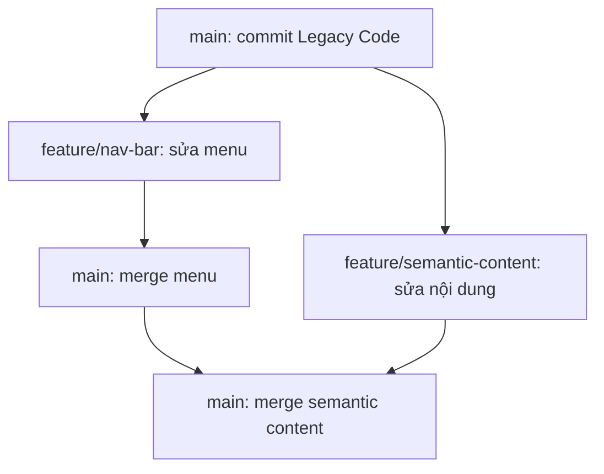

# Chiến dịch Tái thiết Portal TechBugs

> Bài thực hành Git Branching & Merging và HTML Semantic.

## 1. Mục tiêu

- Làm việc trên hai nhánh tính năng độc lập thay vì chỉnh sửa trực tiếp toàn bộ trên `main`.
- Chuyển cấu trúc HTML cũ sử dụng nhiều `<div>` sang các thẻ ngữ nghĩa phù hợp.
- Tạo menu điều hướng theo cấu trúc `<nav>` → `<ul>` → `<li>` → `<a>`.
- Hợp nhất hai nhánh vào `main`, kiểm tra HTML và lịch sử Git.

## 2. Thông tin dự án

- **Tên dự án:** TechBugs Portal
- **Ngôn ngữ:** HTML (và CSS nếu cần giữ giao diện)
- **Repository GitHub:** `https://github.com/<username>/<repository>` *(thay bằng link thật khi nộp)*
- **Nhánh chính:** `main`
- **Nhánh menu:** `feature/nav-bar`
- **Nhánh nội dung:** `feature/semantic-content`

## 3. Phân tích cấu trúc HTML

| Khối Legacy | Cấu trúc đề xuất | Ý nghĩa |
|---|---|---|
| `.top-bar` | `<header>` | Phần đầu trang |
| `.menu` | `<nav>` chứa `<ul>` → `<li>` → `<a>` | Khu vực điều hướng |
| `.main-content` | `<main>` | Nội dung chính của trang |
| Nhóm tin theo chủ đề | `<section>` (khi phù hợp) | Nhóm nội dung có chủ đề/tiêu đề |
| `.news-block` | `<article>` (nếu là một tin độc lập) | Bài viết/tin có thể đứng riêng |
| `.bottom-bar` | `<footer>` | Phần cuối trang |

**Lưu ý:** Không thay thế mọi `<div>` một cách máy móc. Chỉ dùng thẻ semantic khi phù hợp với ý nghĩa nội dung. Để xác định chính xác từng vị trí, cần đối chiếu với toàn bộ mã HTML gốc do giảng viên cung cấp.

## 4. Quy trình thực hiện

### Bước 1: Tạo commit gốc trên `main`

Tạo thư mục dự án, đặt mã **Legacy Code** được cung cấp trong bài học vào `index.html`, sau đó chạy:

```bash
git init
git branch -M main
git add index.html
git commit -m "chore: add legacy portal"
```

Commit này là điểm xuất phát chung cho hai nhánh tính năng.

### Bước 2: Phát triển menu trên nhánh `feature/nav-bar`

```bash
git switch main
git switch -c feature/nav-bar
```

Chỉnh sửa **riêng khối menu** trong `index.html` bằng các thẻ `<nav>`, `<ul>`, `<li>`, `<a>`; kiểm tra các liên kết điều hướng, sau đó:

```bash
git add index.html
git commit -m "feat: rebuild navigation with semantic list"
```

### Bước 3: Phát triển nội dung trên nhánh `feature/semantic-content`

Quay về **commit gốc trên `main`** trước khi rẽ nhánh để hai tính năng độc lập:

```bash
git switch main
git switch -c feature/semantic-content
```

Chỉnh sửa phần đầu trang, nội dung chính, các nhóm tin và chân trang; **không đưa thay đổi menu từ nhánh kia vào nhánh này**. Sau đó:

```bash
git add index.html
git commit -m "feat: introduce semantic page structure"
```

### Bước 4: Merge hai tính năng vào `main`

```bash
git switch main
git merge --no-ff feature/nav-bar
git merge --no-ff feature/semantic-content
```

Tùy cách hai nhánh sửa `index.html`, merge thứ hai có thể xảy ra conflict. Khi đó:

1. Chạy `git status` để xem file bị xung đột.
2. Mở `index.html`, tìm các dấu `<<<<<<<`, `=======`, `>>>>>>>`.
3. Chỉnh sửa thủ công để **giữ cả menu mới và nội dung semantic**, đồng thời loại bỏ dấu conflict.
4. Chạy `git add index.html` và `git commit` để hoàn tất merge.

Không nên chạy bước commit giải quyết conflict nếu không có conflict thực tế.

### Bước 5: Kiểm tra lịch sử và kết quả

```bash
git branch -a
git status
git log --oneline --graph --all --decorate
```

Kiểm tra `index.html` trên `main` để xác nhận cả hai phần đã được tích hợp; mở trang trên trình duyệt để thử menu và bố cục.

### Bước 6: Đẩy mã nguồn lên GitHub

Sau khi tạo repository trống trên GitHub và lấy URL chính xác:

```bash
git remote add origin https://github.com/<username>/<repository>.git
git push -u origin main
git push -u origin feature/nav-bar
git push -u origin feature/semantic-content
```

Nếu repository đã có `origin`, hãy kiểm tra bằng `git remote -v` thay vì thêm lại. Hai nhánh tính năng cần được đẩy lên GitHub để giảng viên có thể xem lịch sử của chúng.

## 5. Sơ đồ phân nhánh dự kiến



> Đây là sơ đồ **quy trình dự kiến**, không phải bằng chứng về các commit đã thực hiện. Dùng `git log --oneline --graph --all --decorate` để xem lịch sử thực tế.

## 6. Tiêu chí tự kiểm tra

- [ ] `main` có commit ban đầu chứa đúng Legacy Code.
- [ ] `feature/nav-bar` chỉ tập trung vào menu.
- [ ] `feature/semantic-content` được tạo từ `main` gốc và tập trung vào cấu trúc nội dung.
- [ ] Menu có cấu trúc `<nav>` → `<ul>` → `<li>` → `<a>`.
- [ ] Dùng `<header>`, `<main>`, `<section>`, `<article>`, `<footer>` đúng ngữ nghĩa.
- [ ] Hai nhánh tính năng đã được merge vào `main`.
- [ ] Không còn dấu merge conflict trong `index.html`.
- [ ] `git log --graph` thể hiện lịch sử phân nhánh và merge.
- [ ] Đã push `main` và hai nhánh tính năng lên GitHub.
- [ ] Có file `ai_prompt_log.md` ghi lại **các prompt thực tế** và lý do sử dụng.

## 7. Giải thích một số quyết định thiết kế

**Vì sao dùng `<ul>` thay vì `<ol>` cho menu?** Menu là tập hợp liên kết không yêu cầu thứ tự đánh số. `<ul>` phù hợp hơn; `<ol>` chỉ dùng khi thứ tự mang ý nghĩa.

**Vì sao bọc menu bằng `<nav>`?** `<nav>` xác định vùng liên kết điều hướng quan trọng, giúp mô tả ý nghĩa cấu trúc trang cho trình duyệt và công nghệ hỗ trợ.

**Vì sao phải quay về `main` trước khi tạo nhánh thứ hai?** Để `feature/semantic-content` xuất phát từ commit chung, không vô tình kế thừa các commit menu từ `feature/nav-bar`.

**Merge hoạt động ra sao?** Git tìm điểm chung trong lịch sử để kết hợp thay đổi. Với `--no-ff`, Git tạo merge commit để thể hiện việc tích hợp nhánh. Nếu hai phía có thay đổi không thể tự hòa giải, người phát triển phải giải quyết conflict.

## 8. Hồ sơ nộp bài

- **GitHub Repository:** `https://github.com/<username>/<repository>` *(cập nhật link thật)*
- **`index.html`:** Sản phẩm HTML cuối cùng trên nhánh `main`.
- **`ai_prompt_log.md`:** Những prompt **đã thực sự dùng** khi trao đổi với AI, kèm lý do hỏi và kiến thức rút ra.
- **`README.md`:** Mô tả mục tiêu, hướng triển khai, quy trình Git và tiêu chí kiểm tra (file này).

**Trạng thái:** Tài liệu hướng dẫn triển khai. Các ô kiểm và link GitHub cần được cập nhật sau khi bạn thực hành xong.
