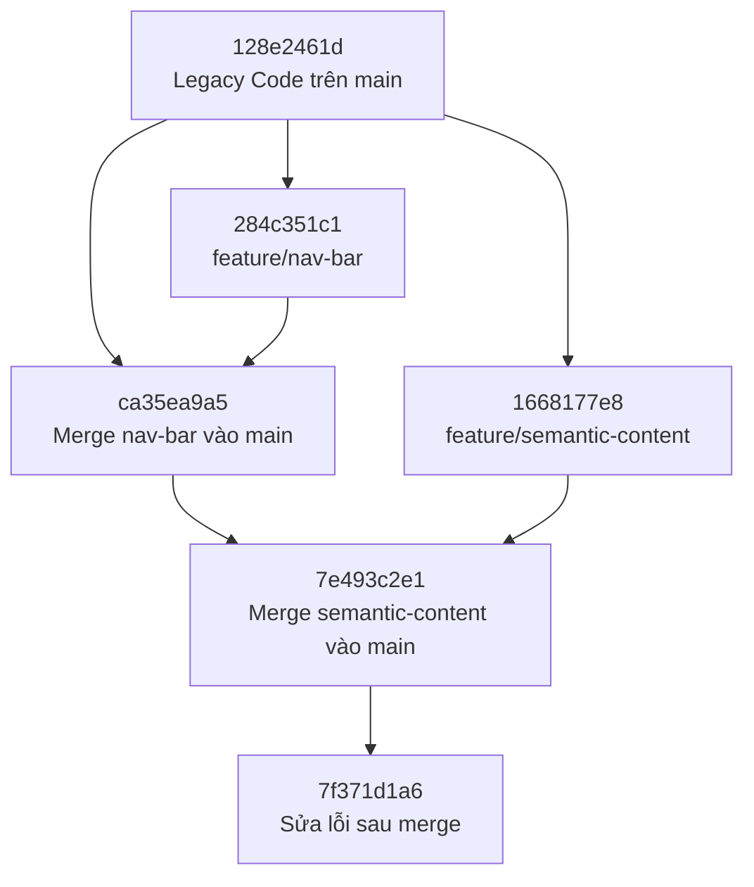

# Chiến dịch Tái thiết Portal TechBugs

> **Bài thực hành:** Git Branching & Merging kết hợp HTML Semantic  
> **Repository:** [dieppham999/portal_techbugs](https://github.com/dieppham999/portal_techbugs)  
> **Ngày đối chiếu lịch sử Git:** 12/11/2026

## Tổng quan

Dự án cải tiến Portal TechBugs theo hai hướng:

1. **Git workflow:** Tách hai tính năng thành các nhánh độc lập và hợp nhất vào `main` bằng merge commit.
2. **HTML Semantic:** Chuyển bố cục từ các khối `div` thiếu ngữ nghĩa sang những phần tử HTML phù hợp; chuẩn hóa danh sách điều hướng.

**Lưu ý:** Các SHA và liên kết commit bên dưới phản ánh lịch sử Git đã được đối chiếu, **không phải kế hoạch hoặc commit giả lập**. Sơ đồ Mermaid là minh họa rút gọn của lịch sử này.

---

## 1. Bằng chứng lịch sử Git

### 1.1. Các commit quan trọng

| Sự kiện | Commit | Liên kết kiểm chứng |
|---|---|---|
| Commit gốc chứa Legacy Code | `128e2461d` | [Xem commit](https://github.com/dieppham999/portal_techbugs/commit/128e2461d) |
| Phát triển menu trên `feature/nav-bar` | `284c351c1` | [Xem commit](https://github.com/dieppham999/portal_techbugs/commit/284c351c1) |
| Phát triển nội dung trên `feature/semantic-content` | `1668177e8` | [Xem commit](https://github.com/dieppham999/portal_techbugs/commit/1668177e8) |
| Merge menu vào `main` (2 parents) | `ca35ea9a5` | [Xem merge commit](https://github.com/dieppham999/portal_techbugs/commit/ca35ea9a5) |
| Merge nội dung vào `main` (2 parents) | `7e493c2e1` | [Xem merge commit](https://github.com/dieppham999/portal_techbugs/commit/7e493c2e1) |
| Sửa lỗi phát sinh sau merge | `7f371d1a6` | [Xem commit](https://github.com/dieppham999/portal_techbugs/commit/7f371d1a6) |

**Các nhánh:** [`main`](https://github.com/dieppham999/portal_techbugs/tree/main) · [`feature/nav-bar`](https://github.com/dieppham999/portal_techbugs/tree/feature/nav-bar) · [`feature/semantic-content`](https://github.com/dieppham999/portal_techbugs/tree/feature/semantic-content)

### 1.2. Quan hệ giữa các nhánh

- `284c351c1` và `1668177e8` đều có commit cha là **`128e2461d`**: hai nhánh tính năng được phát triển độc lập từ cùng một điểm gốc.
- Merge `ca35ea9a5` có hai parents: **`128e2461d`** và **`284c351c1`**.
- Merge `7e493c2e1` có hai parents: **`ca35ea9a5`** và **`1668177e8`**.



> **Chú ý:** Sơ đồ trên minh họa quan hệ commit, không thay thế ảnh chụp `git log --graph` thực tế.

### 1.3. Tự kiểm chứng trên máy

Chạy các lệnh sau trong bản clone của repository:

```bash
git fetch --all --prune
git log --all --oneline --graph --decorate
git branch -a
```

Chụp màn hình kết quả `git log` để đính kèm hồ sơ nộp bài. Có thể đối chiếu thêm tại [GitHub Network Graph](https://github.com/dieppham999/portal_techbugs/network).

---

## 2. Chuyển đổi HTML Semantic

### 2.1. Bảng ánh xạ cấu trúc

| Legacy HTML | Phần tử thay thế | Lý do |
|---|---|---|
| `.top-bar` | `<header>` | Phần đầu trang |
| `.menu` | `<nav>` → `<ul>` → `<li>` → `<a>` | Vùng điều hướng chính và danh sách liên kết |
| `.main-content` | `<main>` | Nội dung chính của trang |
| Nhóm tin có tiêu đề | `<section>` | Gom các nội dung liên quan theo chủ đề |
| `.news-block` | `<article>` | Bài viết/tin có thể đứng độc lập |
| `.title` | `<h3>` | Heading theo cấp trong nhóm tin |
| `.author`, `.text` | `<p>`, `<time>` | Đoạn văn và ngày tháng có thể đọc bằng máy |
| `.bottom-bar` | `<footer>` | Phần cuối trang |

> Cấp heading như `<h3>` phải phù hợp với phân cấp tiêu đề thực tế. Không thay mọi `div` thành `section` một cách máy móc.

### 2.2. Các nguyên tắc áp dụng

- **Menu:** Mỗi mục điều hướng độc lập dùng một `<li>` chứa một `<a>`; tránh đặt bốn liên kết chung trong một `<li>`.
- **Ngữ nghĩa:** Dùng heading, `<p>` và `<time>` cho tiêu đề, đoạn văn, thời gian; chỉ dùng `<section>` khi thực sự có nhóm nội dung theo chủ đề.
- **CSS:** Đặt quy tắc giao diện trong `styles.css`, tránh `style` inline.
- **Điều hướng:** Các liên kết nội bộ trỏ đến ID có tồn tại trên trang.
- **Dữ liệu minh họa:** Các phần sản phẩm, tuyển dụng và liên hệ chỉ phục vụ bài thực hành, không phải thông tin doanh nghiệp chính thức.

---

## 3. Kiến thức vấn đáp với Tech Lead

### 3.1. Vì sao dùng `<ul>` thay vì `<ol>`?

Menu là tập hợp các đường dẫn mà thứ tự không quyết định ý nghĩa. Vì vậy, `<ul>` phù hợp hơn. `<ol>` thích hợp khi thứ tự là thông tin quan trọng, ví dụ quy trình thao tác tuần tự.

### 3.2. Vì sao `<nav>` bọc ngoài `<ul>`?

`<nav>` xác định vùng điều hướng quan trọng (navigation landmark) cho công nghệ hỗ trợ. `<ul>` thể hiện mối quan hệ danh sách giữa các mục. Không phải mọi nhóm liên kết đều cần được đặt trong `<nav>`.

### 3.3. Vì sao nhánh thứ hai phải được tạo từ `main`?

Hai nhánh cùng xuất phát từ commit `128e2461d`. Nếu tạo `feature/semantic-content` khi vẫn đứng ở `feature/nav-bar`, nhánh mới sẽ kế thừa commit menu, khiến lịch sử hai tính năng không còn độc lập.

### 3.4. `git merge` hoạt động như thế nào?

Khi hai nhánh đã phân kỳ, Git thường dùng **three-way merge**:

1. Tìm **merge-base** (tổ tiên chung gần nhất phù hợp).
2. So sánh thay đổi từ merge-base đến từng đầu nhánh.
3. Kết hợp thay đổi tự động nếu có thể; nếu không sẽ báo conflict.

Tùy tình huống, `git merge` có thể fast-forward thay vì tạo merge commit. Tùy chọn `--no-ff` yêu cầu tạo merge commit ngay cả khi fast-forward là khả thi; không có một “lệnh bí mật” khác được chạy ngầm.

### 3.5. Nếu hai nhánh cùng sửa một vùng code thì xử lý conflict thế nào?

1. Chạy `git status` để xem file xung đột.
2. Mở file và tìm các dấu `<<<<<<<`, `=======`, `>>>>>>>`.
3. Đối chiếu hai phía, chỉnh lại thành nội dung HTML mong muốn.
4. Xóa toàn bộ dấu conflict, kiểm tra HTML và các liên kết.
5. Chạy:

   ```bash
   git add index.html
   git commit
   ```

Có thể nghiên cứu điểm chung bằng `git merge-base`; với lịch sử đã merge, nên chỉ định SHA của các commit tại thời điểm cần so sánh thay vì mặc định dùng các đầu nhánh hiện tại.

### 3.6. Nếu đang sửa dở tính năng nhưng cần chuyển về `main`?

Có thể dùng `git stash` để cất tạm thay đổi, sau đó quay lại tiếp tục:

```bash
git stash push -m "WIP nav"
git switch main
# Sửa và commit phần việc cần xử lý trên main
git switch feature/nav-bar
git stash pop
```

Một lựa chọn khác là tạo commit WIP trên nhánh tính năng nếu cần lưu thay đổi vào lịch sử.

---

## 4. Kiểm thử và hồ sơ nộp bài

### 4.1. Những bằng chứng đã xác minh (12/11/2026)

- [x] Có ba nhánh `main`, `feature/nav-bar`, `feature/semantic-content` trên GitHub.
- [x] Có commit gốc lưu Legacy Code.
- [x] Hai nhánh tính năng có cùng commit cha gốc.
- [x] Có hai merge commit, mỗi commit có hai parents.

### 4.2. Các bước cần xác nhận sau khi cập nhật bản sửa

- [ ] `index.html` trên `main` có HTML Semantic đúng yêu cầu.
- [ ] `styles.css` được đưa lên GitHub và liên kết đúng với HTML.
- [ ] Menu hoạt động trên trình duyệt, các liên kết nội bộ hợp lệ.
- [ ] Chụp ảnh `git log --all --oneline --graph --decorate` và bổ sung vào repository.
- [ ] `ai_prompt_log.md` có các prompt thực tế đã sử dụng; phân biệt rõ nội dung mô phỏng nếu có.
- [ ] Kiểm tra toàn bộ README và trạng thái các file trên `main` trước khi nộp lại.

### 4.3. Hồ sơ nộp

| Tài liệu | Mục đích |
|---|---|
| [GitHub Repository](https://github.com/dieppham999/portal_techbugs) | Kiểm tra branches, commits và merge history |
| [`index.html`](https://github.com/dieppham999/portal_techbugs/blob/main/index.html) | Sản phẩm HTML sau hợp nhất |
| `styles.css` | Định dạng giao diện (khi đã push) |
| `ai_prompt_log.md` | Lịch sử tương tác AI thực tế (khi đã bổ sung) |
| `README.md` | Tổng hợp quy trình, giải thích và bằng chứng |

---


